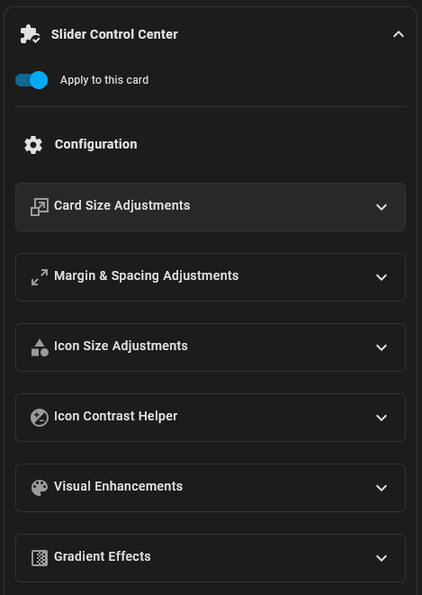
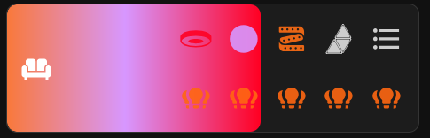
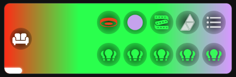

# Visual Styling Center

**Version:** v2026.10.15
**Creator:** [HyperCriSiS](https://github.com/HyperCriSiS)

> [!IMPORTANT] 
> **Unsupported cards:**
>  - Cover
>  - Climate
>  - Horizontal buttons stack
>  - Media player
>  - Pop-up
>  - Select
>  - Separator


## Overview

The Visual Styling Center module offers advanced customization options for Bubble Card elements with a focus on visual enhancements.
It provides precise control over Icon and card sizes, spacing, colors, and visual effects like gradients.

## IMPORTANT
Due to the nature of the sections layout, you have to use the HA internal mechanism to resize the card.
It means that the "Card Height Multiplier" only works with the other layouts.
Also with sections layout, you need to use the bubble-card grid layout if you use two row sub-buttons layout.
So generally, if something does not work out as expected, try out a different bubble-card layout.

```markdown
# Visual Styling Center for Bubble Card

## Core Features
- **Comprehensive size and margin adjustments** for cards, icons, and sub-buttons
- **Advanced color options** for all elements
- **Entity state-based icon coloring** for both main and sub-button icons
- **Function button styling** for inactive states and functional entities
- **Icon Contrast Helper** for better readability with radial background effects
- **Dynamic gradient effects** based on light entities
- **Slider Contrast Helper** for improved visibility with background gradients
- **Hover effects** for improved user experience
- **Automatic adjustments** for optimal display
- **Custom Slider** to see more of the visuals 

## Detailed Feature Description

### Card Size Adjustments
- **Card Height Multiplier**: Scale the overall height of your Bubble Card 

### Margin & Spacing Adjustments
- **Main Icon Vertical Margin**: Adjust vertical spacing for the main icon 
- **Sub-button Container Right Margin**: Control the right margin of the sub-button container 
- **Sub-button Row Spacing**: Set the spacing between rows of sub-buttons 
- **Sub-button Column Spacing**: Set the spacing between columns of sub-buttons 
- **Inner Card Padding**: Add padding inside the card for more spacing

### Icon Size Adjustments
- **Main Icon Size Multiplier**: Scale the size of the main icon 
- **Icon Background Ratio**: Adjust the size ratio of the icon background 
- **Sub-icon Size Multiplier**: Scale the size of sub-button icons 
- **Sub-button Background Ratio**: Adjust the size ratio of sub-button backgrounds 

### Visual Enhancements
- **Hide Icon Background**: Remove the background from the main icon
- **Hide Sub-button Backgrounds**: Remove backgrounds from all sub-buttons
- **Custom Icon Colors**: Set custom colors for main icon and sub-icons
- **Custom Background Colors**: Set custom colors for icon and sub-button backgrounds
- **Entity-Colored Main Icon**: Automatically color the main icon based on its entity state
- **Entity-Colored Sub-Icons**: Automatically color sub-buttons based on their entity state
- **Custom Offline/Function Button Color**: Apply a custom color to icons for inactive states, functional entities (scenes, scripts, automations), or entities without states

### Icon Contrast Helper
The Icon Contrast Helper adds circular background behind icons to improve visibility and contrast regardless of the card's background color.
- **Enable Icon Contrast Helper**: Toggle the helper feature on/off
- **Apply to Main/Sub Icons**: Choose which icons get the contrast helper
- **Helper Color**: Select the background color for the helper
- **Helper Opacity**: Control the transparency of the helper background 
- **Helper Size Ratio**: Adjust how much of the icon the background covers 
- **Radial Fade Effect**: Enable a smooth fade from color to transparent
- **Fade Strength**: Control how gradual the fade effect is 

### Gradient Effects
- **Enable Gradient Effects**: Toggle dynamic gradients on/off
- **Apply Gradient to**: Choose between slider fill or card background
- **Gradient Entity**: Select a light group or single light to base the gradient on
- **Hide Gradient When All Lights Off**: Option to show/hide gradient when no lights are active

### Slider Contrast Helper
When using background gradients, this feature improves the visibility of the slider element.
- **Enable Slider Contrast Helper**: Toggle the helper for slider with background gradients
- **Slider Helper Color**: Select the background/glow color for the slider
- **Slider Helper Opacity**: Control the transparency of the helper effect
- **Slider Helper Size Ratio**: Adjust the size of the helper effect
- **Enable Radial Fade Effect**: Add a smooth fade to the slider glow
- **Slider Fade Strength**: Control the intensity of the fade effect
- **Slider Brightness**: Adjust the opacity of the slider when using background gradients

### Compatibility
- Works with all button layouts (normal, large, multi-row)
- Compatible with entity state tracking for dynamic changes
- Handles entities without states or non-existent entities
```

> **Note**: When enabling the Icon Contrast Helper, sub-button backgrounds are automatically hidden to prevent visual conflicts.

## Usage Examples

### Basic Height Adjustment

```yaml
visual_styling_center:
  height_multiplier: 1.5
```

### Custom Colors with Icon Helper

```yaml
visual_styling_center:
  custom_icon_color: [255, 255, 255]
  custom_icon_background_color: [0, 0, 0]
  enable_icon_helper: true
  helper_color: [255, 255, 255]
  helper_opacity: 0.7
  helper_size_ratio: 1.2
  enable_helper_fade: true
  fade_strength: 1.2
```

### Dynamic Gradient Effects

```yaml
visual_styling_center:
  enable_gradient: true
  gradient_target: background
  gradient_entity: light.living_room_group
  disable_default_gradient: false
  slider_bg_opacity: 0.8
```

---

<details>

<summary><b>Get this Module</b></summary>

<br>

> To use this module, simply copy and paste the following configuration into your `/www/bubble/bubble-modules.yaml` file.

```yaml
visual_styling_center:
  name: "Visual Styling Center"
  version: "v2026.10.15"
  creator: "HyperCriSiS"
  link: "https://github.com/Clooos/Bubble-Card/discussions/1314"
  description: Comprehensive customization tool for Bubble Card elements with focus on gradient effects and icon styling for both card and sub-buttons.
  unsupported:
    - cover
    - climate
    - horizontal-buttons-stack
    - media-player
    - pop-up
    - select
    - separator
  editor:
    - type: expandable
      title: "Card Size Adjustments"
      icon: "mdi:resize"
      schema:
        - name: height_multiplier
          label: "Card Height Multiplier"
          default: 1
          selector:
            number:
              min: 0.8
              max: 5.0
              step: 0.1
              mode: slider
              unit_of_measurement: "×"
    - type: expandable
      title: "Margin & Spacing Adjustments"
      icon: "mdi:arrow-expand"
      schema:
        - name: inner_padding
          label: "Inner Card Padding"
          default: 0
          selector:
            number:
              min: 0
              max: 30
              step: 1
              mode: slider
              unit_of_measurement: "px"
        - name: icon_vertical_margin
          label: "Main Icon Vertical Margin"
          default: 6
          selector:
            number:
              min: -10
              max: 30
              step: 1
              mode: slider
              unit_of_measurement: "px"
        - name: subbutton_horizontal_margin
          label: "Sub-button Container Right Margin"
          default: 8
          selector:
            number:
              min: -10
              max: 30
              step: 1
              mode: slider
              unit_of_measurement: "px"
        - name: subbutton_row_spacing
          label: "Space Between Sub-button Rows"
          default: 10
          selector:
            number:
              min: 0
              max: 30
              step: 1
              mode: slider
              unit_of_measurement: "px"
        - name: subbutton_column_spacing
          label: "Space Between Sub-button Columns"
          default: 10
          selector:
            number:
              min: -10
              max: 30
              step: 1
              mode: slider
              unit_of_measurement: "px"
    - type: expandable
      title: "Icon Size Adjustments"
      icon: "mdi:shape"
      schema:
        - name: icon_size_multiplier
          label: "Main Icon Size Multiplier"
          default: 1
          selector:
            number:
              min: 0.8
              max: 3.0
              step: 0.1
              mode: slider
              unit_of_measurement: "×"
        - name: icon_background_ratio
          label: "Icon Background Ratio"
          default: 1
          selector:
            number:
              min: 0.6
              max: 1.4
              step: 0.05
              mode: slider
              unit_of_measurement: "×"
        - name: subicon_size_multiplier
          label: "Sub-icon Size Multiplier"
          default: 1
          selector:
            number:
              min: 0.8
              max: 3.0
              step: 0.1
              mode: slider
              unit_of_measurement: "×"
        - name: subbutton_background_ratio
          label: "Sub-button Background Ratio"
          default: 1
          selector:
            number:
              min: 0.6
              max: 1.4
              step: 0.05
              mode: slider
              unit_of_measurement: "×"
    - type: expandable
      title: "Icon Contrast Helper"
      icon: "mdi:contrast-circle"
      schema:
        - name: enable_icon_helper
          label: "Enable Icon Contrast Helper"
          default: false
          selector:
            boolean: {}
        - name: apply_to_main_icon
          label: "Apply Helper to Main Icon"
          default: true
          selector:
            boolean: {}
        - name: apply_to_sub_icons
          label: "Apply Helper to Sub-Icons"
          default: true
          selector:
            boolean: {}
        - name: helper_color
          label: "Helper Background Color (RGB)"
          selector:
            color_rgb: {}
        - name: manual_helper_color
          label: "Manual Helper Color (e.g. #FFFFFF or rgba(255,255,255,0.8))"
          selector:
            text: {}
        - name: helper_opacity
          label: "Helper Background Opacity"
          default: 0.7
          selector:
            number:
              min: 0.1
              max: 1.0
              step: 0.05
              mode: slider
        - name: helper_size_ratio
          label: "Helper Size Ratio"
          default: 0.7
          selector:
            number:
              min: 0.3
              max: 1.5
              step: 0.05
              mode: slider
              unit_of_measurement: "×"
        - name: enable_helper_fade
          label: "Enable Radial Fade Effect"
          default: true
          selector:
            boolean: {}
        - name: fade_strength
          label: "Fade Strength"
          default: 1.0
          selector:
            number:
              min: 0.5
              max: 2.0
              step: 0.1
              mode: slider
    - type: expandable
      title: "Slider Contrast Helper"
      icon: "mdi:contrast-box"
      schema:
        - name: enable_slider_helper
          label: "Enable Slider Contrast Helper"
          default: false
          selector:
            boolean: {}
        - name: slider_helper_color
          label: "Slider Helper Background Color (RGB)"
          selector:
            color_rgb: {}
        - name: manual_slider_helper_color
          label: "Manual Slider Helper Color (e.g. #FFFFFF or rgba(255,255,255,0.8))"
          selector:
            text: {}
        - name: slider_helper_opacity
          label: "Slider Helper Background Opacity"
          default: 0.7
          selector:
            number:
              min: 0.1
              max: 1.0
              step: 0.05
              mode: slider
        - name: slider_helper_size_ratio
          label: "Slider Helper Size Ratio"
          default: 0.7
          selector:
            number:
              min: 0.3
              max: 4.0
              step: 0.1
              mode: slider
              unit_of_measurement: "×"
        - name: enable_slider_helper_fade
          label: "Enable Radial Fade Effect"
          default: true
          selector:
            boolean: {}
        - name: slider_fade_strength
          label: "Slider Fade Strength"
          default: 1.0
          selector:
            number:
              min: 0.5
              max: 2.0
              step: 0.1
              mode: slider
    - type: expandable
      title: "Visual Enhancements"
      icon: "mdi:palette"
      schema:
        - name: hide_icon_background
          label: "Hide Icon Background"
          default: false
          selector:
            boolean: {}
        - name: hide_subbutton_background
          label: "Hide Sub-button Backgrounds"
          default: false
          selector:
            boolean: {}
        - name: custom_icon_color
          label: "Icon Color (RGB)"
          selector:
            color_rgb: {}
        - name: manual_icon_color
          label: "Manual Icon Color (e.g. #FFFFFF or rgba(255,255,255,0.8))"
          selector:
            text: {}
        - name: custom_subicon_color
          label: "Sub-Button Icon Color (RGB)"
          selector:
            color_rgb: {}
        - name: manual_subicon_color
          label: "Manual Sub-Button Icon Color (e.g. #FFFFFF or rgba(255,255,255,0.8))"
          selector:
            text: {}
        - name: custom_icon_background_color
          label: "Icon Background Color (RGB)"
          selector:
            color_rgb: {}
        - name: manual_icon_background_color
          label: "Manual Icon Background Color (e.g. #FFFFFF or rgba(255,255,255,0.8))"
          selector:
            text: {}
        - name: custom_subbutton_background_color
          label: "Sub-Button Background Color (RGB)"
          selector:
            color_rgb: {}
        - name: manual_subbutton_background_color
          label: "Manual Sub-Button Background Color (e.g. #FFFFFF or rgba(255,255,255,0.8))"
          selector:
            text: {}
        - name: enable_entity_colored_main_icon
          label: "Color Main Icon by Entity State"
          default: false
          selector:
            boolean: {}
        - name: enable_entity_colored_subicons
          label: "Color Sub-Button Icons by Entity State"
          default: false
          selector:
            boolean: {}
        - name: enable_function_button_color
          label: "Custom Offline/Function Button Color"
          default: false
          selector:
            boolean: {}
        - name: function_button_color
          label: "Offline/Function Button Color (RGB)"
          selector:
            color_rgb: {}
        - name: manual_function_button_color
          label: "Manual Offline/Function Button Color (e.g. #FFFFFF or rgba(255,255,255,0.8))"
          selector:
            text: {}
    - type: expandable
      title: "Gradient Effects"
      icon: "mdi:gradient-horizontal"
      schema:
        - name: enable_gradient
          label: "Enable Gradient Effects"
          default: false
          selector:
            boolean: {}
        - name: gradient_target
          label: "Apply Gradient to"
          default: "slider"
          selector:
            select:
              options:
                - value: "slider"
                  label: "Slider Fill"
                - value: "background"
                  label: "Card Background"
        - name: gradient_entity
          label: "Gradient Entity (Light Group or Single Light)"
          selector:
            entity:
              domain: light
        - name: disable_default_gradient
          label: "Hide Gradient When All Lights Off"
          default: false
          selector:
            boolean: {}
        - name: slider_bg_opacity
          label: "Slider Brightness with Background Gradient"
          default: 0.6
          selector:
            number:
              min: 0.1
              max: 1.0
              step: 0.05
              mode: slider
  code: |
   ${(() => {
      const config = this.config.visual_styling_center || {};
      // Keep each inline CSS variable's pre-module value. Without ownership,
      // an unset VSC option would delete another module's or theme's overrides.
      const ownedVariables = card._vscOwnedVariables ?? (card._vscOwnedVariables = new Map());
      const restoreOwnedVariable = (name) => {
        const saved = ownedVariables.get(name);
        if (!saved) return;
        if (card.style.getPropertyValue(name) === saved.applied) {
          if (saved.previous) card.style.setProperty(name, saved.previous, saved.priority);
          else card.style.removeProperty(name);
        }
        ownedVariables.delete(name);
      };
      const setCardVariable = (name, value) => {
        if (value == null) {
          restoreOwnedVariable(name);
          return;
        }
        const desired = String(value);
        const current = card.style.getPropertyValue(name);
        let saved = ownedVariables.get(name);
        if (!saved) {
          saved = { previous: current, priority: card.style.getPropertyPriority(name), applied: desired };
          ownedVariables.set(name, saved);
        } else {
          saved.applied = desired;
        }
        if (current !== desired) card.style.setProperty(name, desired);
      };
      // onTeardown fires when Bubble Card detaches a card, including view
      // caching/re-attachment. Keep registration idempotent across style passes.
      const vscClassNames = [
        'slider-background-mode', 'vsc-custom-subbutton-background',
        'use-function-button-color', 'hide-icon-background',
        'hide-subbutton-background', 'icon-helper-enabled',
        'helper-fade-enabled', 'helper-main-icon', 'helper-sub-icons',
        'slider-helper-enabled', 'slider-helper-fade-enabled',
        'use-gradient-background', 'use-gradient-slider'
      ];
      const initialClasses = card._vscInitialClasses ?? (card._vscInitialClasses =
        new Map(vscClassNames.map(name => [name, card.classList.contains(name)])));

      // Derive defaults without mutating the saved Bubble Card configuration.
      const gradientTarget = config.gradient_target ?? 'slider';
      const gradientEntity = config.gradient_entity ||
        (this.config.entity?.startsWith('light.') ? this.config.entity : null);
      if (gradientTarget === 'background' && config.enable_gradient) {
        card.classList.add('slider-background-mode');
      } else {
        card.classList.remove('slider-background-mode');
      }
      // Apply all size and spacing configurations
      setCardVariable('--height-multiplier', config.height_multiplier);
      setCardVariable('--inner-padding', config.inner_padding == null ? null : `${config.inner_padding}px`);
      setCardVariable('--icon-vertical-margin', config.icon_vertical_margin == null ? null : `${config.icon_vertical_margin}px`);
      setCardVariable('--subbutton-horizontal-margin', config.subbutton_horizontal_margin == null ? null : `${config.subbutton_horizontal_margin}px`);
      setCardVariable('--subbutton-row-spacing', config.subbutton_row_spacing == null ? null : `${config.subbutton_row_spacing}px`);
      setCardVariable('--subbutton-column-spacing', config.subbutton_column_spacing == null ? null : `${config.subbutton_column_spacing}px`);
      setCardVariable('--icon-size-multiplier', config.icon_size_multiplier);
      setCardVariable('--icon-background-ratio', config.icon_background_ratio);
      setCardVariable('--subicon-size-multiplier', config.subicon_size_multiplier);
      setCardVariable('--subbutton-background-ratio', config.subbutton_background_ratio);
      if (config.slider_bg_opacity !== undefined) {
        setCardVariable('--slider-bg-opacity', config.slider_bg_opacity);
      } else {
        setCardVariable('--slider-bg-opacity', 0.6);
      }

      // Only keep module-owned variables while an option has a value.
      const resolveColor = (manual, selected) => {
        if (typeof manual === 'string' && manual.trim()) return manual;
        if (Array.isArray(selected) && selected.length === 3) {
          return `rgb(${selected[0]}, ${selected[1]}, ${selected[2]})`;
        }
        return typeof selected === 'string' && selected.trim() ? selected : null;
      };
      setCardVariable('--icon-color', resolveColor(config.manual_icon_color, config.custom_icon_color));
      setCardVariable('--subicon-color', resolveColor(config.manual_subicon_color, config.custom_subicon_color));
      const customSubbuttonBackground = resolveColor(config.manual_subbutton_background_color, config.custom_subbutton_background_color);
      setCardVariable('--subbutton-background-color', customSubbuttonBackground);
      // Keep the native on/off background and v3.4.2 contrast unless overridden.
      card.classList.toggle('vsc-custom-subbutton-background', customSubbuttonBackground != null);
      const iconBackgroundColor = resolveColor(config.manual_icon_background_color, config.custom_icon_background_color);
      setCardVariable('--icon-background-color', config.hide_icon_background === true ? 'transparent' : iconBackgroundColor);

      const functionButtonColor = config.enable_function_button_color === true
        ? (resolveColor(config.manual_function_button_color, config.function_button_color) ?? 'rgba(255, 255, 255, 0.9)')
        : null;
      setCardVariable('--function-button-color', functionButtonColor);
      card.classList.toggle('use-function-button-color', functionButtonColor != null);

      // Apply background visibility toggling
      card.classList.toggle('hide-icon-background', config.hide_icon_background === true);

      // Apply sub-button background visibility - automatically hide if helper is enabled
      if (config.hide_subbutton_background === true || config.enable_icon_helper === true) {
        card.classList.add('hide-subbutton-background');
      } else {
        card.classList.remove('hide-subbutton-background');
      }

      // The CSS .hide-subbutton-background class handles this; avoid inline
      // writes that could overwrite Bubble Card or another module's own styling.

      // Restore only inline styles owned by this module. Native Bubble Card
      // can update other inline styles independently during state changes.
      function applyOwnedIconColor(icon, color) {
        if (!icon) return;
        if (color != null) {
          if (!Object.prototype.hasOwnProperty.call(icon.dataset, 'vscAppliedColor')) {
            icon.dataset.vscPreviousColor = icon.style.getPropertyValue('color');
            icon.dataset.vscPreviousPriority = icon.style.getPropertyPriority('color');
          }
          if (icon.style.getPropertyValue('color') !== color || icon.style.getPropertyPriority('color') !== 'important') {
            icon.style.setProperty('color', color, 'important');
          }
          icon.dataset.vscAppliedColor = color;
        } else if (Object.prototype.hasOwnProperty.call(icon.dataset, 'vscAppliedColor')) {
          if (icon.style.getPropertyValue('color') === icon.dataset.vscAppliedColor) {
            if (icon.dataset.vscPreviousColor) {
              icon.style.setProperty('color', icon.dataset.vscPreviousColor, icon.dataset.vscPreviousPriority);
            } else {
              icon.style.removeProperty('color');
            }
          }
          delete icon.dataset.vscAppliedColor;
          delete icon.dataset.vscPreviousColor;
          delete icon.dataset.vscPreviousPriority;
        }
      }

      function getEntityColor(entityId) {
        const entityState = hass?.states?.[entityId];
        if (!entityId || !entityState) return null;
        if (entityState.state === 'on' && Array.isArray(entityState.attributes?.rgb_color)) {
          const rgb = entityState.attributes.rgb_color;
          return `rgb(${rgb[0]}, ${rgb[1]}, ${rgb[2]})`;
        }
        const activeStates = ['on', 'home', 'active', 'open', 'unlocked', 'detected'];
        const inactiveStates = ['off', 'away', 'inactive', 'closed', 'locked', 'clear'];
        const errorStates = ['unavailable', 'unknown'];
        const isFunction = /^(scene|script|automation)\./.test(entityId);
        if (isFunction && functionButtonColor != null) return functionButtonColor;
        if (activeStates.includes(entityState.state)) return 'rgb(140, 200, 105)';
        if (inactiveStates.includes(entityState.state) || errorStates.includes(entityState.state)) {
          if (functionButtonColor != null) return functionButtonColor;
          return inactiveStates.includes(entityState.state) ? 'rgb(150, 150, 150)' : 'rgb(180, 180, 180)';
        }
        return null;
      }

      function getFunctionOnlyColor(entityId) {
        if (functionButtonColor == null) return null;
        const st = hass?.states?.[entityId];
        if (!entityId || !st || /^(scene|script|automation)\./.test(entityId)) return functionButtonColor;
        return ['off', 'away', 'inactive', 'closed', 'locked', 'clear', 'unavailable', 'unknown'].includes(st.state)
          ? functionButtonColor : null;
      }

      const mainEntityId = this.config.entity;
      const mainColor = (config.enable_entity_colored_main_icon === true && getEntityColor(mainEntityId)) ||
        getFunctionOnlyColor(mainEntityId);
      applyOwnedIconColor(card.querySelector('.bubble-icon'), mainColor);

      // Match Bubble Card's actual class numbering in updateGroupButtons().
      // In mixed layouts explicit groups are indexed first, followed by the
      // implicit main group, then bottom groups and bottom individual buttons.
      // Flattening YAML order directly would color the wrong icons.
      const subButtonConfigs = [];
      const collectSubButtons = (items) => {
        if (!Array.isArray(items)) return;
        items.forEach(item => {
          if (!item) return;
          if (Array.isArray(item.group)) collectSubButtons(item.group);
          else subButtonConfigs.push(item);
        });
      };
      const configuredSubButtons = this.config.sub_button;
      const mainItems = Array.isArray(configuredSubButtons) ? configuredSubButtons
        : (Array.isArray(configuredSubButtons?.main) ? configuredSubButtons.main : []);
      const bottomItems = Array.isArray(configuredSubButtons?.bottom) ? configuredSubButtons.bottom : [];
      const mainGroups = mainItems.filter(item => Array.isArray(item?.group) && item.group.length > 0);
      const bottomGroups = bottomItems.filter(item => Array.isArray(item?.group) && item.group.length > 0);
      const mainSingles = mainItems.filter(item => item && !Array.isArray(item.group));
      const bottomSingles = bottomItems.filter(item => item && !Array.isArray(item.group));
      const mainLayout = configuredSubButtons?.main_layout ?? 'inline';
      const mainUsesAutoGroup = mainLayout === 'rows' || mainGroups.length > 0 ||
        bottomGroups.length > 0 || bottomSingles.length > 0;
      if (!mainUsesAutoGroup) collectSubButtons(mainSingles);
      mainGroups.forEach(item => collectSubButtons(item.group));
      if (mainUsesAutoGroup) collectSubButtons(mainSingles);
      bottomGroups.forEach(item => collectSubButtons(item.group));
      collectSubButtons(bottomSingles);
      subButtonConfigs.forEach((buttonConfig, index) => {
        const icon = card.querySelector(`.bubble-sub-button-${index + 1} .bubble-sub-button-icon`);
        // Bubble Card falls back to the parent entity when the sub-button has none.
        const entityId = buttonConfig.entity ?? this.config.entity;
        const color = (config.enable_entity_colored_subicons === true && getEntityColor(entityId)) ||
          getFunctionOnlyColor(entityId);
        applyOwnedIconColor(icon, color);
      });

      // Icon Contrast Helper Implementation
      if (config.enable_icon_helper === true) {
        card.classList.add('icon-helper-enabled');

        // Set helper colors and properties
        let helperColor;
        if (config.manual_helper_color) {
          helperColor = config.manual_helper_color;
        } else if (config.helper_color) {
          const colorArray = config.helper_color;
          helperColor = Array.isArray(colorArray)
            ? `rgba(${colorArray[0]}, ${colorArray[1]}, ${colorArray[2]}, ${config.helper_opacity ?? 0.7})`
            : colorArray;
        } else {
          // Default to a light grey if no color specified
          helperColor = `rgba(255, 255, 255, ${config.helper_opacity ?? 0.7})`;
        }

        setCardVariable('--helper-color', helperColor);
        setCardVariable('--helper-size', config.helper_size_ratio ?? 0.7);
        setCardVariable('--fade-strength', config.fade_strength ?? 1.0);

        if (config.enable_helper_fade === true) {
          card.classList.add('helper-fade-enabled');
        } else {
          card.classList.remove('helper-fade-enabled');
        }

        if (config.apply_to_main_icon !== false) {
          card.classList.add('helper-main-icon');
        } else {
          card.classList.remove('helper-main-icon');
        }

        if (config.apply_to_sub_icons !== false) {
          card.classList.add('helper-sub-icons');
        } else {
          card.classList.remove('helper-sub-icons');
        }
      } else {
        card.classList.remove('icon-helper-enabled', 'helper-fade-enabled', 'helper-main-icon', 'helper-sub-icons');
      }

      // Slider Contrast Helper Implementation - Only apply when Card Background gradient is active
      if (config.enable_slider_helper === true && gradientTarget === 'background' && config.enable_gradient === true) {
        card.classList.add('slider-helper-enabled');

        // Set slider helper colors and properties
        let sliderHelperColor;
        if (config.manual_slider_helper_color) {
          sliderHelperColor = config.manual_slider_helper_color;
        } else if (config.slider_helper_color) {
          const colorArray = config.slider_helper_color;
          sliderHelperColor = Array.isArray(colorArray)
            ? `rgba(${colorArray[0]}, ${colorArray[1]}, ${colorArray[2]}, ${config.slider_helper_opacity ?? 0.7})`
            : colorArray;
        } else {
          // Default to black if no color specified
          sliderHelperColor = `rgba(0, 0, 0, ${config.slider_helper_opacity ?? 0.7})`;
        }

        setCardVariable('--slider-helper-color', sliderHelperColor);
        setCardVariable('--slider-helper-size', config.slider_helper_size_ratio ?? 0.7);
        setCardVariable('--slider-fade-strength', config.slider_fade_strength ?? 1.0);

        if (config.enable_slider_helper_fade === true) {
          card.classList.add('slider-helper-fade-enabled');
        } else {
          card.classList.remove('slider-helper-fade-enabled');
        }
      } else {
        card.classList.remove('slider-helper-enabled', 'slider-helper-fade-enabled');
      }

      // Collect the final gradient before updating the DOM.
      let appliedGradient = null;

      if (config.enable_gradient === true && gradientEntity) {
        const entityId = gradientEntity;
        const entityState = hass?.states?.[entityId];
        let coloredLights = [];

        // Get light colors from group or single light
        if (Array.isArray(entityState?.attributes?.entity_id)) {
          entityState.attributes.entity_id.forEach(childId => {
            if (childId.startsWith('light.')) {
              const lightState = hass?.states?.[childId];
              if (lightState?.state === 'on' && Array.isArray(lightState.attributes?.rgb_color) && lightState.attributes.rgb_color.length >= 3) {
                coloredLights.push({
                  rgb: lightState.attributes.rgb_color,
                  brightness: lightState.attributes.brightness || 255,
                  friendly_name: lightState.attributes.friendly_name || childId
                });
              }
            }
          });
        } else if (entityState?.state === 'on' && Array.isArray(entityState.attributes?.rgb_color) && entityState.attributes.rgb_color.length >= 3) {
          coloredLights.push({
            rgb: entityState.attributes.rgb_color,
            brightness: entityState.attributes.brightness || 255,
            friendly_name: entityState.attributes.friendly_name || entityId
          });
        }

        // Always read child states above: Bubble Card's trackedHass observes
        // these dependencies and will refresh on external child RGB changes.
        // hasChanged only skips expensive hue sorting when the inputs are equal.
        const gradientProperty = gradientTarget === 'background' ? '--card-gradient' : '--slider-gradient';
        const gradientInputs = coloredLights.map(light => light.rgb.slice(0, 3).join(','));
        const needsGradientRebuild = typeof hasChanged !== 'function' ||
          hasChanged('vsc-gradient', gradientEntity, gradientTarget, config.disable_default_gradient === true, gradientInputs);
        const previousGradient = card.style.getPropertyValue(gradientProperty);

        if (!needsGradientRebuild && previousGradient) {
          appliedGradient = previousGradient;
        } else if (coloredLights.length > 0) {
          // RGB to HSL conversion helper
          const rgbToHsl = (r, g, b) => {
            r /= 255; g /= 255; b /= 255;
            const max = Math.max(r, g, b), min = Math.min(r, g, b);
            let h, s, l = (max + min) / 2;
            if (max === min) {
              h = s = 0;
            } else {
              const d = max - min;
              s = l > 0.5 ? d / (2 - max - min) : d / (max + min);
              switch (max) {
                case r: h = (g - b) / d + (g < b ? 6 : 0); break;
                case g: h = (b - r) / d + 2; break;
                case b: h = (r - g) / d + 4; break;
              }
              h /= 6;
            }
            return [h * 360, s * 100, l * 100];
          };

          // Sort lights by hue for smoother gradients
          const sortedLights = [...coloredLights].sort((a, b) => {
            const [h1] = rgbToHsl(a.rgb[0], a.rgb[1], a.rgb[2]);
            const [h2] = rgbToHsl(b.rgb[0], b.rgb[1], b.rgb[2]);
            return h1 - h2;
          });

          // Generate gradient based on number of lights
          let gradientColors = '';
          if (sortedLights.length === 1) {
            const light = sortedLights[0];
            const [h, s, l] = rgbToHsl(light.rgb[0], light.rgb[1], light.rgb[2]);
            gradientColors = `
              hsl(${h}, ${s}%, ${Math.max(l - 15, 0)}%) 0%,
              hsl(${h}, ${s}%, ${l}%) 50%,
              hsl(${h}, ${s}%, ${Math.min(l + 15, 100)}%) 100%
            `;
          } else if (sortedLights.length === 2) {
            gradientColors = `rgb(${sortedLights[0].rgb[0]}, ${sortedLights[0].rgb[1]}, ${sortedLights[0].rgb[2]}) 0%, rgb(${sortedLights[1].rgb[0]}, ${sortedLights[1].rgb[1]}, ${sortedLights[1].rgb[2]}) 100%`;
          } else {
            const stops = [];
            const n = sortedLights.length;

            // Create gradient stops distributed across the range
            for (let i = 0; i < n; i++) {
              let pos = (i / (n - 1)) * 100;
              stops.push({ rgb: sortedLights[i].rgb, position: Math.round(pos) });
            }
            gradientColors = stops.map(stop => `rgb(${stop.rgb[0]}, ${stop.rgb[1]}, ${stop.rgb[2]}) ${stop.position}%`).join(', ');
          }

          appliedGradient = `linear-gradient(to right, ${gradientColors})`;
        } else if (config.disable_default_gradient !== true) {
          // Fallback rainbow gradient if no colored lights are found and option is not disabled
          appliedGradient = 'linear-gradient(to right, #FF0000, #FF7F00, #FFFF00, #00FF00, #0000FF, #4B0082, #9400D3)';
        }
      }

      const backgroundGradientActive = appliedGradient != null && gradientTarget === 'background';
      card.classList.toggle('use-gradient-background', backgroundGradientActive);
      card.classList.toggle('use-gradient-slider', appliedGradient != null && !backgroundGradientActive);
      setCardVariable('--card-gradient', backgroundGradientActive ? appliedGradient : null);
      setCardVariable('--slider-gradient', backgroundGradientActive ? null : appliedGradient);

      // Restore our own changes when disconnected OR when the module is
      // removed from a still-mounted card using setConfig(). Bubble Card's
      // native onTeardown currently runs on disconnect, not on this edit path.
      const cleanupVSC = () => {
        Array.from(ownedVariables.keys()).forEach(restoreOwnedVariable);
        applyOwnedIconColor(card.querySelector('.bubble-icon'), null);
        card.querySelectorAll('.bubble-sub-button-icon').forEach(icon => applyOwnedIconColor(icon, null));
        initialClasses.forEach((wasPresent, name) => card.classList.toggle(name, wasPresent));
        if (card._vscOwnedVariables === ownedVariables) delete card._vscOwnedVariables;
        if (card._vscInitialClasses === initialClasses) delete card._vscInitialClasses;
      };
      // Update the current cleanup callback on each pass without stacking hooks.
      this._vscCleanupCurrent = cleanupVSC;
      if (typeof this.setConfig === 'function' && !this._vscSetConfigWrapper) {
        const host = this;
        const originalSetConfig = this.setConfig;
        const wrappedSetConfig = function(nextConfig) {
          const previousCode = String(host.config?.styles ?? '');
          const incomingCode = String(nextConfig?.styles ?? '');
          // Only react to removing the inline VSC source: other cards/modules
          // may legitimately use styles without embedding VSC source.
          if (previousCode.includes('this.config.visual_styling_center') &&
              !incomingCode.includes('this.config.visual_styling_center')) {
            host._vscCleanupCurrent?.();
          }
          return originalSetConfig.call(this, nextConfig);
        };
        this._vscSetConfigWrapper = { originalSetConfig, wrappedSetConfig };
        this.setConfig = wrappedSetConfig;
      }
      if (typeof onTeardown === 'function') {
        onTeardown(() => {
          cleanupVSC();
          const wrapper = this._vscSetConfigWrapper;
          if (wrapper && this.setConfig === wrapper.wrappedSetConfig) {
            this.setConfig = wrapper.originalSetConfig;
          }
          delete this._vscSetConfigWrapper;
          delete this._vscCleanupCurrent;
        });
      }

      return '';
    })()}
    /* Card size adjustments */
    .bubble-button-card-container {
      height: calc(var(--height-multiplier, 1) * 50px) !important;
      box-sizing: border-box !important;
      /* Reduce z-index to avoid conflicts with editor menus */
      z-index: 0 !important; /* Further reduced to prevent any menu conflicts */
    }
    /* Inner padding adjustments */
    .bubble-button-card {
      padding: var(--inner-padding, 0px) !important;
      box-sizing: border-box !important;
      height: 100% !important;
    }
    /* Native Bubble Card manages default slider colors and interaction states.
       VSC only overrides the main slider when an explicit gradient is active. */

    /* Gradient slider styles - target only the slider fill */
    .use-gradient-slider .bubble-button-card-container > .bubble-range-slider > .bubble-range-fill {
      background: var(--slider-gradient) !important;
      background-size: 100% 100% !important;
      background-position: center !important;
      border-radius: 12px !important;
      opacity: 1 !important;
    }

    /* Card background gradient styles */
    .use-gradient-background .bubble-button-card {
      background: var(--card-gradient) !important;
      position: relative !important;
    }

    /* Improve slider visibility with background gradient - move to bottom edge */
    .use-gradient-background .bubble-button-card-container > .bubble-range-slider > .bubble-range-fill {
      background-color: rgba(255, 255, 255, var(--slider-bg-opacity, 0.6)) !important; /* Higher contrast */
      box-shadow: 0 0 4px rgba(255, 255, 255, 0.8) !important; /* Glow effect */
      height: 12px !important; /* Thinner height */
      border-radius: 6px !important;
      top: auto !important; /* Remove vertical centering */
      bottom: 0px !important; /* Position at bottom with small margin */
      z-index: 1 !important;
    }

    /* Slider Contrast Helper Implementation - creating a glow effect around the edges */
    .slider-helper-enabled.use-gradient-background .bubble-button-card-container > .bubble-range-slider > .bubble-range-fill {
      /* Maintain existing styles but add glow effect */
      box-shadow: 0 0 calc(3px * var(--slider-helper-size, 0.7)) var(--slider-helper-color, rgba(0, 0, 0, 0.7)) !important;
    }

    .slider-helper-fade-enabled.use-gradient-background .bubble-button-card-container > .bubble-range-slider > .bubble-range-fill {
      /* For the fade effect, a more complex shadow with variable fade strength */
      box-shadow: 
        0 0 calc(2px * var(--slider-helper-size, 0.7)) var(--slider-helper-color, rgba(0, 0, 0, 0.7)),
        0 0 calc(6px * var(--slider-helper-size, 0.7)) var(--slider-helper-color, rgba(0, 0, 0, 0.5)),
        0 0 calc(12px * var(--slider-fade-strength, 1.0)) var(--slider-helper-color, rgba(0, 0, 0, 0.3)) !important;
    }

    /* Make sure other elements stay on top but don't interfere with menus */
    .bubble-icon-container, 
    .bubble-name-container,
    .bubble-sub-button-container {
      z-index: 1 !important;
      position: relative !important;
    }
    /* Apply independent row and column spacing to sub-buttons */
    .bubble-sub-button-container {
      margin-right: var(--subbutton-horizontal-margin, 8px) !important;
      row-gap: var(--subbutton-row-spacing, 10px) !important;
      column-gap: var(--subbutton-column-spacing, 10px) !important;
    }
    /* Make sub-buttons size independent from main icon margin */
    .bubble-sub-button {
      height: calc(var(--subbutton-background-ratio, 1) * var(--height-multiplier, 1) * 32px) !important;
      min-height: calc(var(--subbutton-background-ratio, 1) * var(--height-multiplier, 1) * 32px) !important;
    }
    .vsc-custom-subbutton-background .bubble-sub-button {
      background-color: var(--subbutton-background-color) !important;
    }
    /* Hide sub-button backgrounds when option is enabled - with !important to override inline styles */
    .hide-subbutton-background .bubble-sub-button {
      background-color: transparent !important;
      background: none !important;
      border-color: transparent !important;
      box-shadow: none !important;
    }
    /* Apply margins to icon container - separate from sub-buttons */
    .bubble-icon-container {
      margin: var(--icon-vertical-margin, 6px) !important;
      min-height: calc(var(--icon-size-multiplier, 1) * var(--icon-background-ratio, 1) * 38px) !important;
      height: calc(var(--icon-size-multiplier, 1) * var(--icon-background-ratio, 1) * 38px) !important;
      width: calc(var(--icon-size-multiplier, 1) * var(--icon-background-ratio, 1) * 38px) !important;
      min-width: calc(var(--icon-size-multiplier, 1) * var(--icon-background-ratio, 1) * 38px) !important;
      background-color: var(--icon-background-color, var(--bubble-icon-background-color, var(--bubble-secondary-background-color))) !important;
    }
    /* Specific rule to fully hide icon background when enabled */
    .hide-icon-background .bubble-icon-container {
      background-color: transparent !important;
      background: none !important;
    }
    /* Adjust main icon size and color according to multiplier */
    .bubble-icon-container .bubble-icon {
      --mdc-icon-size: calc(var(--icon-size-multiplier, 1) * 24px) !important;
      color: var(--icon-color, inherit) !important;
    }
    /* Scale sub-button icons with independent multiplier */
    .bubble-sub-button .bubble-sub-button-icon {
      --mdc-icon-size: calc(var(--subicon-size-multiplier, 1) * 18px) !important;
      color: var(--subicon-color, inherit) !important;
    }

    /* Function/Offline button color styling - now includes main icon */
    .use-function-button-color .bubble-sub-button ha-icon[style*="rgb(150, 150, 150)"],
    .use-function-button-color .bubble-sub-button ha-icon[style*="rgb(180, 180, 180)"] {
      color: var(--function-button-color, rgba(255, 255, 255, 0.9)) !important;
    }

    /* Enhanced styling for entity colored sub-icons */
    .bubble-sub-button ha-icon,
    .bubble-sub-button-icon ha-icon,
    .bubble-sub-button-icon,
    .bubble-icon-container .bubble-icon {
      transition: color 0.3s ease !important;
    }
    /* Large layout support */
    .large .bubble-button-card-container {
      height: calc(var(--height-multiplier, 1) * var(--row-height, 56px) * var(--row-size, 1) + var(--row-gap, 8px) * (var(--row-size, 1) - 1)) !important;
    }
    .large .bubble-icon-container {
      margin: var(--icon-vertical-margin, 8px) !important;
      min-height: calc(var(--icon-size-multiplier, 1) * var(--icon-background-ratio, 1) * 42px) !important;
      height: calc(var(--icon-size-multiplier, 1) * var(--icon-background-ratio, 1) * 42px) !important;
      width: calc(var(--icon-size-multiplier, 1) * var(--icon-background-ratio, 1) * 42px) !important;
      min-width: calc(var(--icon-size-multiplier, 1) * var(--icon-background-ratio, 1) * 42px) !important;
    }
    /* Large layout icon sizing */
    .large .bubble-icon-container .bubble-icon {
      --mdc-icon-size: calc(var(--icon-size-multiplier, 1) * 24px) !important;
    }
    /* Line height adjustment for name container */
    .bubble-name-container {
      line-height: calc(var(--height-multiplier, 1) * 18px);
    }
    /* Multi-row layout support with independent sub-button sizing */
    .rows-2 .bubble-sub-button {
      height: calc(var(--subbutton-background-ratio, 1) * var(--height-multiplier, 1) * 20px) !important;
    }
    /* Large layout sub-button margin */
    .large .bubble-sub-button-container {
      margin-right: var(--subbutton-horizontal-margin, 14px) !important;
      row-gap: var(--subbutton-row-spacing, 10px) !important;
      column-gap: var(--subbutton-column-spacing, 10px) !important;
    }
    /* Large layout sub-button icon sizing */
    .large .bubble-sub-button .bubble-sub-button-icon {
      --mdc-icon-size: calc(var(--subicon-size-multiplier, 1) * 18px) !important;
    }

    /* Icon Contrast Helper */
    .icon-helper-enabled.helper-main-icon .bubble-icon {
      position: relative !important;
      z-index: 2 !important;
    }

    .icon-helper-enabled.helper-main-icon .bubble-icon::before {
      content: "" !important;
      position: absolute !important;
      width: calc(100% * var(--helper-size, 0.7)) !important;
      height: calc(100% * var(--helper-size, 0.7)) !important;
      background-color: var(--helper-color, rgba(255, 255, 255, 0.7)) !important;
      border-radius: 50% !important;
      z-index: -1 !important;
      top: 50% !important;
      left: 50% !important;
      transform: translate(-50%, -50%) !important;
      transition: all 0.2s ease !important;
    }

    .icon-helper-enabled.helper-fade-enabled.helper-main-icon .bubble-icon::before {
      background: radial-gradient(circle, var(--helper-color, rgba(255, 255, 255, 0.7)) 0%, transparent calc(100% * var(--fade-strength, 1.0))) !important;
    }

    .icon-helper-enabled.helper-sub-icons .bubble-sub-button ha-icon,
    .icon-helper-enabled.helper-sub-icons .bubble-sub-button-icon ha-icon {
      position: relative !important;
      z-index: 2 !important;
    }

    .icon-helper-enabled.helper-sub-icons .bubble-sub-button ha-icon::before,
    .icon-helper-enabled.helper-sub-icons .bubble-sub-button-icon ha-icon::before {
      content: "" !important;
      position: absolute !important;
      width: calc(100% * var(--helper-size, 0.7)) !important;
      height: calc(100% * var(--helper-size, 0.7)) !important;
      background-color: var(--helper-color, rgba(255, 255, 255, 0.7)) !important;
      border-radius: 50% !important;
      z-index: -1 !important;
      top: 50% !important;
      left: 50% !important;
      transform: translate(-50%, -50%) !important;
      transition: all 0.2s ease !important;
    }

    .icon-helper-enabled.helper-fade-enabled.helper-sub-icons .bubble-sub-button ha-icon::before,
    .icon-helper-enabled.helper-fade-enabled.helper-sub-icons .bubble-sub-button-icon ha-icon::before {
      background: radial-gradient(circle, var(--helper-color, rgba(255, 255, 255, 0.7)) 0%, transparent calc(100% * var(--fade-strength, 1.0))) !important;
    }

    /* Make sub-button icons brighter and more visible */
    .bubble-sub-button ha-icon {
      opacity: 0.9 !important;
    }

    /* Enhance icons in active states for better visibility */
    .is-on .bubble-icon {
      opacity: 1 !important;
      filter: brightness(1.1) !important;
    }

    /* Highlight elements on hover/focus for better interaction cues */
    .bubble-sub-button:hover ha-icon,
    .bubble-sub-button:focus ha-icon,
    .bubble-icon-container:hover .bubble-icon,
    .bubble-icon-container:focus .bubble-icon {
      filter: brightness(1.2) !important;
    }
```
</details>

### Screenshots




